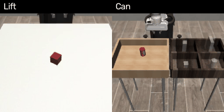

# ACT Reimplementation

A from-scratch reimplementation of [Action Chunking with Transformers (ACT)](https://tonyzhaozh.github.io/aloha/) for robot imitation learning, focusing on chunked action prediction, CVAE-based style encoding, and temporal ensembling for smooth real-robot deployment.

## Demo



ACT (temporal ensembling) in the shared Franka simulation ([robot-sim](https://github.com/YahuanShi/robot-sim)): robomimic Lift and Can,
closed loop from 84×84 camera images. Real-robot demo pending (no real-robot data yet).


---

## 1. Motivation

This is a **from-scratch reimplementation** of ACT, not a fork. Every line of code is written by hand after studying the original paper and codebase. The primary goal is to deeply understand how action chunking and CVAE-based style encoding work in a visuomotor imitation learning setting; the secondary goal is to provide a clean, minimal codebase others can learn from.

### Differences from the Original

| Aspect | [Original (Zhao et al.)](https://github.com/tonyzhaozh/act) | This Project |
|--------|-------------------------------------------------------------|--------------|
| **Code origin** | Complete ALOHA framework (~5k LOC) | From-scratch rewrite (~6k LOC + 1.4k tests) |
| **Config system** | argparse + hardcoded constants | Plain argparse, single `train.py` |
| **Data format** | HDF5 / RoboMimic | LeRobot v3 (modern standard) |
| **EMA** | Not used | Buffer-aware EMA for stable inference |
| **Image augmentation** | Random crop only | `RandomCenterCrop` + `ColorJitter` (opt-in via `--crop_ratio`, `--color_jitter`) |
| **LR schedule** | Constant | Cosine annealing with warmdown |
| **Checkpointing** | Epoch only | Epoch + step-level (crash recovery) |
| **Comments** | Minimal | Learning-note style: explains the *why* behind each design |
| **Environment** | conda + pip | `bash setup.sh` one-click (uv) |

### ACT vs. Diffusion Policy

Both projects share the same robot hardware (UR5 + Weiss CRG gripper + dual RealSense). The key difference is in how they represent the action distribution:

| | ACT | Diffusion Policy |
|--|-----|-----------------|
| **Action representation** | Deterministic transformer (z=0 at inference) | Iterative denoising (100 DDPM / 16 DDIM steps) |
| **Multimodality** | CVAE latent at training time only | Full denoising trajectory at inference |
| **Inference speed** | ~1 forward pass | 16 forward passes (DDIM; 100 with DDPM) |
| **Temporal context** | Single frame (no obs history) | Obs history window (To frames) |
| **Smoothing** | Temporal ensembling | Action chunking (execute n steps) |
| **Strength** | Fast, smooth via ensembling | Better multimodal coverage |

---

## 2. ACT

ACT is a robot imitation learning method from [Zhao et al., 2023 (RSS)](https://tonyzhaozh.github.io/aloha/) that predicts a **chunk** of future actions at each timestep rather than a single action. The key insight is that chunked prediction reduces the **effective decision horizon** and suppresses compounding errors — the same mechanism that makes model-predictive control more robust than single-step reactive policies.

---

### 2.1 Core Concepts

#### 2.1.1 Action Chunking

Standard BC maps one observation to one action. Prediction errors accumulate over T steps:

```
Standard BC:
  obs_t → action_t
  obs_t+1 → action_t+1     (policy sees its own error from step t)
  ...
  (error compounds over T steps)
```

ACT predicts an entire chunk of k future actions in one call, then executes all k before re-querying:

```
ACT (chunk_size = k):

  Query at t:
      obs_t ──────────────► [a_t, a_t+1, ..., a_t+k-1]
                              ↑ single forward pass, k=100 by default

  Execute:
      step t:    send a_t
      step t+1:  send a_t+1   (no new inference, no error feedback)
      ...
      step t+k-1: send a_t+k-1

  Query at t+k:
      obs_t+k ────────────► [a_t+k, ..., a_t+2k-1]
```

Re-planning every k steps means the policy is insulated from single-step noise.
Each chunk is a smooth, consistent trajectory segment — the robot is never asked
to react to its own tiny prediction errors mid-chunk.

---

#### 2.1.2 CVAE Style Encoder (Training Only)

Human demonstrations contain **style variation** even for the same task: the same pick can be fast or slow, arcing or direct. A plain transformer conditioned only on images would average over these modes, producing blurry or hesitant predictions.

ACT introduces a CVAE encoder that captures this style variation as a latent variable `z` during training, then discards it at inference (setting `z = 0`):

```
TRAINING                              INFERENCE
─────────────────────────────         ──────────────────────────
action_seq ──┐                        z = 0  (prior mean)
             ├─► Encoder ─► μ, σ         │
qpos ────────┘         │                 │
                    z ~ N(μ, σ)          │
                        │                │
obs_features ───────────┼───────────►  Decoder ─► action_chunk
                        ↓
                    Decoder ─► action_chunk

Loss = L1(pred, target) + β · KL(N(μ,σ) ‖ N(0,I))
       ↑ reconstruction       ↑ force z toward standard normal
```

`β = kl_weight` (default 10.0) controls the regularization strength.
The latent dimension is `z_dim = 32` (set via `--latent_dim`).

The CVAE acts as a **training-time regularizer**: it forces the decoder to model
the full action distribution rather than collapse to a single trajectory.
At inference, `z = 0` gives a single deterministic prediction — the "average style".

---

#### 2.1.3 DETR-Style Transformer

The architecture follows [DETR (Carion et al., 2020)](https://arxiv.org/abs/2005.12872), originally designed for object detection. The key idea: instead of predicting one output at a time, a fixed set of learned **query tokens** (one per predicted timestep) all attend to the image features in parallel.

```
Visual branch (per camera):
  RGB image (H×W×3)
    └─► ResNet18 (FrozenBatchNorm2d)   ← ImageNet pretrained, frozen BN stats
          └─► feature map (C×h×w)
                └─► 2D sine pos encoding
                      └─► flatten → (h*w, C) tokens

All cameras concatenated → image_tokens (num_cam * h * w, C)

Decoder:
  k action query tokens   (learned, k = chunk_size)
  + z token               (latent style, zero at inference)
        │
        ├─► self-attention among queries
        │
        └─► cross-attention over image_tokens
              │
              └─► linear projection → k action predictions  (k, action_dim)
```

**Why FrozenBatchNorm2d?** Standard BatchNorm computes running stats from the
current batch. With small robot batches (8–16 samples), these estimates are noisy
and hurt training. FrozenBatchNorm uses the fixed ImageNet statistics, letting the
pretrained ResNet backbone work reliably even at small batch sizes.

---

#### 2.1.4 Temporal Ensembling

With standard action chunking, the robot executes all k actions before re-querying.
Temporal ensembling instead re-queries at *every step* and blends the overlapping
predictions using exponential weighting:

```
Step t:   query → [â_t,   â_t+1, â_t+2, ..., â_t+k-1]
Step t+1: query → [â_t+1, â_t+2, â_t+3, ..., â_t+k  ]
Step t+2: query → [â_t+2, â_t+3, â_t+4, ..., â_t+k+1]

At step t+2, three predictions cover timestep t+2:
  w_0 * â_t+2 (from step t,   the OLDEST prediction, weight=1.0)
+ w_1 * â_t+2 (from step t+1,                       weight=e^-k)
+ w_2 * â_t+2 (from step t+2, the NEWEST prediction, weight=e^-2k)
─────────────────────────────────────────────────
  blended_action_t+2  (normalized by sum of weights)
```

`k` is the ensemble decay constant (`--k`, default 0.01). As in the original ACT,
the weights `w_i = exp(-k·i)` are indexed from the **oldest** prediction, so a
larger `k` makes the motion smoother but slower to react to new observations
(old predictions dominate), and `k → 0` approaches a uniform average. With the
default `k = 0.01` and `chunk_size = 100`, the oldest prediction weighs only
~2.7× the newest — close to uniform.

**Cost:** temporal ensembling requires one policy query per step instead of one
per chunk, making it ~`chunk_size`× more expensive. See `scripts/benchmark_inference.py`
to measure latency on your hardware before enabling it on a real robot.

---

### 2.2 Network at a Glance

```
Input:
  qpos  (state_dim,)         ← current joint positions
  image (num_cam, C, H, W)   ← RGB from each camera

                    ┌─────────────────────────────────────┐
  image ───────────►│  ResNet18 × num_cam  (FrozenBN)     │
                    │  2D pos encoding + flatten          │──► image_tokens
                    └─────────────────────────────────────┤
                                                          │
  z (latent, 0 at inference) ──────────────────────────►  │
  k learned action queries ────────────────────────────►  │
                                                          │
                    ┌─────────────────────────────────────┤
                    │  DETR Transformer Decoder           │
                    │ self-attn → cross-attn(image_tokens)│
                    └─────────────────────────────────────┘
                                    │
                                    ▼
                    action_chunk  (chunk_size, action_dim)
```

| Module | Class | Parameters (default config) |
|--------|-------|---------------------------|
| Visual backbone | `Backbone` + `Joiner` | ResNet18, FrozenBatchNorm2d, ImageNet init |
| CVAE encoder | in `DETRVAE` | TransformerEncoder, z_dim=32 (training only) |
| Action decoder | `Transformer` | enc_layers=4, dec_layers=7, nheads=8, hidden=512 |
| Policy wrapper | `ACTPolicy` | L1 + β·KL loss, cosine LR, EMA |

---

## 3. Project Architecture

Same layout and CLI as the [Diffusion Policy reimplementation](https://github.com/YahuanShi/diffusion-policy-reimplementation).

```
.
├── act/
│   ├── model/
│   │   ├── transformer.py          # Transformer encoder, decoder, full enc-dec
│   │   ├── detr_vae.py             # DETRVAE: backbone + CVAE encoder + DETR decoder
│   │   ├── backbone.py             # ResNet18 with FrozenBatchNorm2d
│   │   ├── position_encoding.py    # 1D sinusoidal + 2D sine position encodings
│   │   ├── ema.py                  # Buffer-aware EMA (parameters + buffers)
│   │   └── augmentation.py         # RandomCenterCrop + ColorJitter (train/eval auto-switch)
│   ├── dataset/
│   │   ├── lerobot_wrapper.py      # LeRobot v3 dataset adapter (image + state + action chunk)
│   │   └── normalizer.py           # ACTNormalizer: fit from dataset, normalize qpos/action
│   ├── policy/
│   │   ├── act_policy.py           # ACTPolicy: compute_loss, predict_action, optimizer
│   │   ├── temporal_ensemble.py    # InferencePipeline: chunked execution / temporal ensembling
│   │   └── loader.py               # Load self-contained checkpoints (+ legacy checkpoint dirs)
│   └── control.py                  # Real-robot helpers: precise_wait, gripper hysteresis, timing stats
├── training/
│   └── workspace.py                # Training loop, EMA, episode-level val, checkpoints, wandb
├── evaluation/
│   ├── offline.py                  # Open-loop L1 vs recorded actions on held-out episodes
│   ├── runner.py                   # Rollout runner (success via info['is_success']) + mock env
│   ├── aloha_env.py                # gym-aloha (MuJoCo) adapter → ACT observation format
│   ├── sim_policy.py               # Adapter for the shared Franka simulation (../robot-sim)
│   └── trial_recorder.py           # Save real-robot trials (videos, actions, outcome)
├── tests/                          # pytest: policy, normalizer, ensembling, EMA, control, trials, integration
├── scripts/
│   ├── hdf5_to_lerobot.py          # HDF5 robot episodes → LeRobot v3 format
│   ├── visualize_dataset.py        # Plot action distributions and trajectories
│   ├── benchmark_inference.py      # Measure inference latency (chunk_size, cameras)
│   └── summarize_trials.py         # Success rate (with 95% CI) + demo GIF from recorded trials
├── experiments/                    # Step-by-step validation scripts (run in order)
│   ├── 01_transformer_test.py      # Transformer encoder/decoder shapes and gradients
│   ├── 02_backbone_test.py         # ResNet18 backbone feature extraction
│   ├── 03_cvae_test.py             # CVAE latent space and KL divergence
│   ├── 04_model_test.py            # Full DETRVAE forward pass
│   ├── 05_policy_test.py           # ACTPolicy loss computation
│   ├── 06_dataset_test.py          # LeRobot dataset loading and batching
│   ├── 07_train_smoke.py           # Short training loop with synthetic data
│   ├── 08_inference_test.py        # InferencePipeline and temporal ensembling
│   └── 09_integration_test.py      # Full pipeline: dataset → train → checkpoint → infer
├── train.py                        # Training entry point
├── eval.py                         # Evaluation entry point (offline / sim / mock)
├── inference.py                    # Real robot inference (UR + Weiss gripper + RealSense)
├── setup.sh                        # One-click environment setup (uv)
└── pyproject.toml                  # Dependencies, ruff config, project metadata
```

---

## 4. Setup

```bash
# One-click install (creates virtual environment via uv)
bash setup.sh

# Or manually
uv venv && uv sync --extra dev

# (Optional) ALOHA MuJoCo simulation for evaluation (gym-aloha)
uv sync --extra dev --extra sim

# (Optional) robot hardware dependencies (ur-rtde, RealSense, serial, OpenCV)
uv sync --extra dev --extra robot

# Install pre-commit hooks
pre-commit install
```

Requires Python 3.10+ and a CUDA-capable GPU for training.

---

## 5. Usage

### Training

> **Epochs here are not the paper's epochs.** One epoch is a pass over *every frame*;
> the original ACT samples one frame per episode per epoch. For ALOHA sim
> (50 episodes × 400 frames, batch 8) one epoch ≈ 2250 steps, so `--epochs 20`
> (≈ 45k steps) is in the range of the paper's training budget, while the paper's
> `2000` would be ~400× longer. `--max_steps` sets an exact step budget instead.

```bash
# ALOHA sim pick-and-place (scripted demos — start here)
python train.py \
    --repo_id lerobot/aloha_sim_transfer_cube_scripted \
    --chunk_size 100 --epochs 20 --batch_size 8 \
    --output_dir outputs/transfer_cube_scripted

# Local dataset (--root must point to the dataset directory, not its parent)
python train.py \
    --repo_id local/ur5_pick_place --root ./data/ur5_pick_place \
    --chunk_size 50 --max_steps 30000 --batch_size 16 --output_dir outputs/ur5

# CVAE ablation on human demos (drop the CVAE encoder, L1 loss only)
python train.py --repo_id lerobot/aloha_sim_transfer_cube_human \
    --chunk_size 100 --epochs 20 --batch_size 8 --no_cvae \
    --output_dir outputs/aloha_transfer_cube_human_nocvae

# With augmentation (random crop to 95% of H/W + color jitter; center crop at eval)
python train.py --repo_id lerobot/aloha_sim_transfer_cube_human \
    --crop_ratio 0.95 --color_jitter

# With wandb logging
python train.py --repo_id lerobot/aloha_sim_transfer_cube_human \
    --wandb --wandb_project ACT --wandb_run_name run1

# Step-level checkpointing for crash recovery (saves every 500 steps, keeps last 3)
python train.py --repo_id lerobot/aloha_sim_transfer_cube_human \
    --save_every_steps 500 --max_keep_checkpoints 3
```

Key arguments:

| Argument | Default | Description |
|----------|---------|-------------|
| `--repo_id` | required | LeRobot dataset repo_id |
| `--root` | None | Local dataset root directory |
| `--episodes` | all | Only use these episode indices (quick debug runs) |
| `--val_ratio` | 0.1 | Fraction of **episodes** held out for validation |
| `--chunk_size` | 100 | Action chunk length (`num_queries`) |
| `--epochs` | 20 | Passes over all frames (see note above) |
| `--max_steps` | None | Exact number of gradient steps (overrides `--epochs`) |
| `--batch_size` | 8 | Batch size |
| `--lr` | 1e-5 | Learning rate |
| `--kl_weight` | 10.0 | CVAE KL divergence weight (β) |
| `--latent_dim` | 32 | CVAE latent dimension |
| `--grad_clip` | 1.0 | Gradient clipping max norm |
| `--lr_backbone` | 1e-5 | Backbone learning rate (0 = frozen backbone) |
| `--crop_ratio` | 1.0 | Random crop to this fraction of H/W in training, center crop at eval (1.0 = off) |
| `--color_jitter` | False | Color jitter during training |
| `--output_dir` | outputs | Where checkpoints, config and plots are written |
| `--save_every_epochs` | 5 | Save a full checkpoint every N epochs |
| `--save_every_steps` | 0 | Save a step checkpoint every N steps (0 = off) |
| `--max_keep_checkpoints` | 5 | Periodic checkpoints to keep (0 = all) |
| `--no_ema` | — | Disable EMA (EMA is on by default) |
| `--wandb` | False | Enable wandb logging |
| `--resume` | None | Path to `checkpoint_full.pt` / `checkpoint_epochN.pt` / `checkpoint_stepN.pt` |

Output files (in `--output_dir`):

- `policy_best.pt` — EMA weights at lowest val loss (computed with the EMA weights) — for deployment
- `policy_final.pt` — EMA weights at the end of training
- `checkpoint_full.pt` — latest full state for `--resume` (policy + EMA + optimizer + epoch), updated every `--save_every_epochs` epochs and at the end
- `checkpoint_epochN.pt` / `checkpoint_stepN.pt` — periodic full checkpoints; resuming from a step checkpoint re-runs the interrupted epoch
- `config.json` — all hyperparameters plus data properties used at deployment (`image_hw`, `fps`, `camera_names`, `val_episodes`, `repo_id`)
- `train_val_*.png` — loss curves (loss, l1, kl)

`policy_best.pt` and `policy_final.pt` are **self-contained** (weights + config + normalizer
stats), so `eval.py` / `inference.py` need only that one file. Checkpoint directories from
before this format (`policy_best.ckpt` + `config.json` + `dataset_stats.pkl`) still load.

### Resume Training

```bash
python train.py \
    --repo_id lerobot/aloha_sim_transfer_cube_human \
    --resume outputs/checkpoint_full.pt \
    --epochs 30
```

### Evaluation

`--checkpoint` takes a `policy_*.pt` file or a training output directory (→ `policy_best.pt`).
Chunked execution is the default; `--temporal_agg` switches to temporal ensembling.

Offline (default): replays the held-out validation episodes stored in the checkpoint,
predicts a chunk at every frame and compares it with the demonstrated actions in raw units
(per-dim L1 at the first step and over the chunk, L1 along the chunk).

```bash
python eval.py --checkpoint outputs/ur5/policy_best.pt
python eval.py --checkpoint outputs/ur5/policy_best.pt --episodes 3 17 42 \
    --plot_dir outputs/ur5/plots --output_json outputs/ur5/offline.json
```

Open-loop error says nothing about compounding errors and multimodal demos make "wrong"
predictions valid, so use it to compare checkpoints and catch broken normalization —
not as a success rate.

Simulation (closed loop, success rate): see [Simulation (Franka Panda)](#simulation-franka-panda)
and [Simulation (ALOHA)](#simulation-aloha).

Mock rollout (pipeline smoke test only):
```bash
python eval.py --checkpoint outputs/ur5/policy_best.pt --mock --n_episodes 2
```

### Simulation (Franka Panda)

While the real robot is unavailable, policies are trained and evaluated in the shared
simulation repo [`../robot-sim`](https://github.com/YahuanShi/robot-sim) (robosuite Franka Panda + robomimic demos,
converted to LeRobot v3: 84×84 agentview + wrist cameras, 9-dim eef state, 10-dim absolute
eef actions with 6D rotation, gripper 1 = open). The Diffusion Policy reimplementation uses
the same environment and seeds, so success rates are directly comparable.

```bash
# one-time: install robot-sim into this environment (opencv<5 matches the headless build here)
uv pip install --python .venv/bin/python -e ../robot-sim "opencv-python<5"

# train on the converted dataset (built in ../robot-sim, see its README)
python train.py --repo_id local/robomimic_lift_ph_abs_84 \
    --root ../robot-sim/data/lerobot/lift_ph_abs_84 \
    --chunk_size 20 --batch_size 32 --epochs 60 --crop_ratio 0.9 --output_dir outputs/sim_lift

# closed-loop evaluation: 50 seeded episodes (seeds 100000+), videos of the first 5
python eval.py --checkpoint outputs/sim_lift --sim lift --n_episodes 50 \
    --video_dir outputs/sim_lift/videos --output_json outputs/sim_lift/eval_chunk.json
python eval.py --checkpoint outputs/sim_lift --sim lift --n_episodes 50 --temporal_agg
```

Results (50 episodes, seeds 100000–100049, 95% Wilson interval, `policy_best`), same
seeds as the Diffusion Policy reimplementation:

| Policy | Training | Lift | Can | Square |
|---|---|---|---|---|
| Diffusion Policy (U-Net) | 30k steps | **50/50 = 100%** (93–100%) | **48/50 = 96%** (87–99%) | 35/50 = 70% (56–81%) |
| ACT, chunked execution | 60 epochs | 50/50 = 100% (93–100%) | 40/50 = 80% (67–89%) | 33/50 = 66% (52–78%) |
| ACT, temporal ensembling | 60 epochs | 50/50 = 100% (93–100%) | 44/50 = 88% (76–94%) | 35/50 = 70% (56–81%) |

Temporal ensembling improves Can from 80% to 88%; most of its failures are seeds that
chunked execution also fails. Diffusion Policy is ahead on Can (clearly against chunked
execution, within noise against temporal ensembling); on Square all three are tied at
66–70%. ACT runs with the paper defaults (chunk 20, kl_weight 10), not tuned for robomimic.

Chunk-size sweep on Can (same recipe, only `--chunk_size` changed):

| Chunk size | Chunked execution | Temporal ensembling |
|---|---|---|
| 10 | 37/50 = 74% (60–84%) | 37/50 = 74% (60–84%) |
| **20** | **40/50 = 80%** (67–89%) | **44/50 = 88%** (76–94%) |
| 50 | 19/50 = 38% (26–52%) | 32/50 = 64% (50–76%) |

Too long a chunk removes closed-loop feedback (chunk 50 = 2.5 s open loop at 20 Hz):
chunked success halves, and temporal ensembling, which re-queries every step, recovers
most of it. Details in the
[robot-sim README](https://github.com/YahuanShi/robot-sim#results-closed-loop-8484-images-absolute-actions).

`robot-sim` is not a declared dependency (CI has no `../robot-sim` checkout): the sim
tests skip when it is not installed, and a later `uv sync` removes it again.

### Simulation (ALOHA)

Rolls out the policy in gym-aloha (MuJoCo, bimanual ViperX, rendered headless via EGL).
Requires `uv sync --extra sim`.

```bash
python eval.py --checkpoint outputs/transfer_cube_scripted --sim aloha_transfer_cube
python eval.py --checkpoint outputs/transfer_cube_scripted --sim aloha_transfer_cube --temporal_agg
python eval.py --checkpoint outputs/insertion --sim aloha_insertion   # train on *_insertion_* first
```

An episode is a success when the env reports `info["is_success"]` (TransferCube:
reward 4 — cube held by the left gripper, off the table). Episode `i` resets with
`--start_seed + i` (default 1000). Without EGL, set `MUJOCO_GL=osmesa`.

Results on TransferCube, trained on the 50 scripted demos with the command from
[Training](#training) (`--chunk_size 100 --epochs 20 --batch_size 8`, `policy_best`),
50 episodes, seeds 1000–1049, 95% Wilson interval:

| Execution | Success | Paper (scripted data) |
|---|---|---|
| Chunked (chunk 100) | **48/50 = 96%** (87–99%) | — |
| Temporal ensembling | 47/50 = 94% (84–98%) | 86% |

Paper: Table I of Zhao et al. (2023), final "Transfer" stage, ACT with temporal ensembling,
3 training seeds × 50 evaluations (this repo: one training seed). The reimplementation
reaches the paper's level on the original ACT task. Temporal ensembling
gives no gain here: scripted demos are smooth and deterministic, so there is little
jitter between overlapping chunks to average out.

Human demos and the CVAE ablation: same command on `lerobot/aloha_sim_transfer_cube_human`
(50 teleoperated demos), with and without `--no_cvae` (drops the CVAE encoder; z = 0 in
training too, L1 loss only). Same seeds and interval as above:

| Model | Chunked (chunk 100) | Temporal ensembling | Paper (human data) |
|---|---|---|---|
| ACT (CVAE) | 25/50 = 50% (37–63%) | **37/50 = 74%** (60–84%) | 50% |
| ACT without CVAE | 28/50 = 56% (42–69%) | 33/50 = 66% (52–78%) | — |

With the CVAE, the reimplementation matches or exceeds the paper's 50% on human data
(Table I, one training seed here). Temporal ensembling helps on human demos (+24 points
with the CVAE; the intervals barely overlap), unlike on the smooth scripted ones.

The CVAE ablation does **not** reproduce the paper's effect: the paper reports 35.3% → 2%
without the CVAE on human data, averaged over TransferCube and Insertion; here the two
models are within noise on TransferCube alone. This run covers one task and one training
seed (Insertion is not tested), so the cause of the difference is open.

### Real Robot Inference (UR + Weiss CRG + RealSense)

Hardware: UR robot arm, Weiss CRG 30-050 gripper, Intel RealSense cameras.

```bash
# Install robot dependencies
uv sync --extra dev --extra robot

# Dry run — full pipeline, but the robot is never moved (no homing, no servo commands)
python inference.py --checkpoint outputs/ur5/policy_best.pt \
    --robot_ip 192.168.1.10 --dry_run

# Real deployment with temporal ensembling (control rate defaults to the dataset fps)
python inference.py --checkpoint outputs/ur5/policy_best.pt \
    --robot_ip 192.168.1.10 --temporal_agg
```

- `--frequency` — control rate in Hz; defaults to the dataset fps stored in the checkpoint and refuses a mismatch unless `--allow_fps_mismatch` is given
- `--temporal_agg`, `--k` — temporal ensembling and its decay constant (default: chunked execution)
- `--max_steps` — control steps per episode (default: 800 = 40 s at 20 Hz; the longest demo is ~33 s)
- `--max_joint_vel` — per-joint velocity clamp in rad/s (default: 1.0)
- `--num_episodes`, `--record_dir` — several rollouts in one session, each recorded (see below)
- `--no_gripper`, `--cam_exterior`, `--cam_wrist` (`''` disables a camera), `--image_size`, `--no_vis`

Consistency with training, all read from the checkpoint:

- **Units and gripper convention** — the training data stores joint angles in **degrees** and the gripper as **1 = open, 0 = closed** (every demonstration starts and ends open). `getActualQ()` radians are converted to degrees for the state and actions are converted back before `servoJ`. Before each episode the robot state is compared with the training statistics; dimensions more than 5σ away are reported (catches deg/rad or gripper-convention mismatches in a new dataset)
- **Image resolution** — frames are center-cropped to the training aspect ratio and resized to `image_hw`
- **Camera order** — follows `camera_names` (matched by the last key segment, e.g. `observation.images.wrist` → `wrist`); a missing camera is an error

Sensors are read by background threads (one per camera, one for the gripper's serial
stream), so `get_obs()` only copies the latest cached readings and never blocks the
control loop; it refuses data older than 0.5 s. Each step runs at an absolute time slot;
the episode ends with the effective control rate and a timing summary (`obs`, `infer`,
`late`, `age`). **Check these in a `--dry_run` before the first real run.** The continuous
gripper channel goes through hysteresis + a 1 s dwell time before it switches the gripper.

### Recording Trials (Demo & Success Rate)

```bash
# 20 rollouts; each is saved to trials/trial_<timestamp>/ (exterior.mp4, wrist.mp4,
# steps.npz, meta.json) and the operator labels it success / failure afterwards
python inference.py --checkpoint outputs/ur5/policy_best.pt --robot_ip 192.168.1.10 \
    --temporal_agg --num_episodes 20 --record_dir trials/

# Success rate per checkpoint with a 95% Wilson interval (dry runs and unanswered trials are skipped)
python scripts/summarize_trials.py --record_dir trials/ --markdown trials/results.md

# Side-by-side camera demo GIF from one trial
python scripts/summarize_trials.py --gif trials/trial_20261020_101500 --out demo.gif
```

### Data Conversion (HDF5 → LeRobot)

```bash
python scripts/hdf5_to_lerobot.py \
    --input /path/to/episodes --repo_id local/my_dataset --root ./data/my_dataset
```

### Scripts

```bash
# Visualize action distributions and episode lengths (sanity check before training)
python scripts/visualize_dataset.py --repo_id lerobot/aloha_sim_transfer_cube_human

# Measure inference latency for different chunk sizes and modes
python scripts/benchmark_inference.py --device cuda --num_cam 2
```

### Tests

```bash
pytest tests/ -v
```

Tests cover the normalizer, policy (incl. augmentation and backbone freezing), temporal
ensembling, EMA, train/val split, control helpers, trial recording, evaluation rollouts and
tools, the Franka sim adapter (skipped without robot-sim) and end-to-end training / resume /
checkpoint loading. They run in CI (`.github/workflows/ci.yml`) together with `ruff check`.

---

## Results

Real robot: pending — no real-robot data yet. The trial tooling is in place (see
[Recording Trials](#recording-trials-demo--success-rate)); results will be filled in with
`scripts/summarize_trials.py`.

Simulation: see [Simulation (Franka Panda)](#simulation-franka-panda) and
[Simulation (ALOHA)](#simulation-aloha).

---

## Acknowledgement

Reference: Zhao et al., "Learning Fine-Grained Bimanual Manipulation with Low-Cost Hardware" (ACT, RSS 2023)

Source repo: https://github.com/tonyzhaozh/act

LeRobot: https://github.com/huggingface/lerobot
